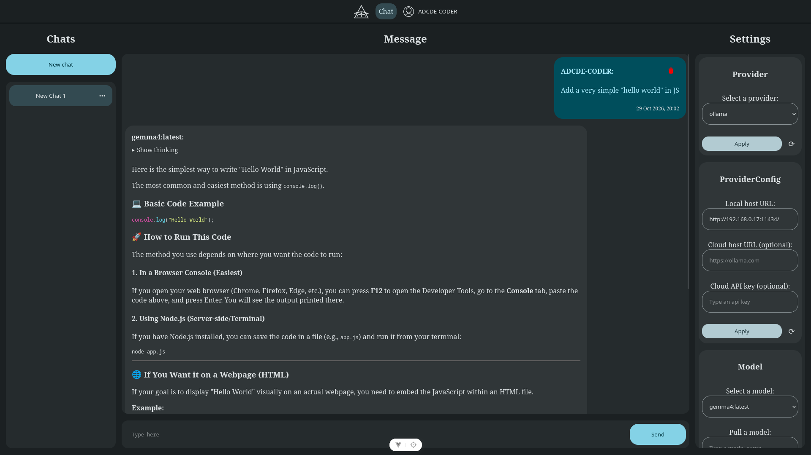

# Observator



> **This project is in early development (prototype stage).**

## Cloning This Repository

You can clone the repository in two ways:

- **Using Git:** Run the following command in a terminal.

  ```sh
  git clone https://github.com/ADCDE-CODER/observator.git
  ```
- **Download ZIP**: On the GitHub page, click the green **Code** button and select **Download ZIP**, then extract the archive.

## Prerequisites

Before you begin, make sure you have the following installed:

- **Node.js** ≥ 18 (LTS recommended)
- **npm** ≥ 9 (ships with Node.js)

## Observator Installation and Setup
### Using npm

1. Navigate to the root directory of the project (the observator folder).
    ```sh
    cd observator
    ```

2. Install the required dependencies.
    ```sh
    npm install
    ```

3. Set up the backend environment variables.

    In the backend folder, create a file named `.env` in the **backend** root directory. Without this file the server will fall back to default values. Once the file is created, copy the template below and replace the placeholder values with your own.
    ```sh
    PORT=3000

    SYSTEM_PROMPT_PATH=src/config/system-prompt.prod.txt

    WHITELIST_OF_MODELS=gemma4:latest,qwen3.5:9b # Add empty value if you want to install all models

    # Ollama
    OLLAMA_LOCAL_HOST_URL=http://localhost:11434
    OLLAMA_CLOUD_HOST_URL=https://ollama.com
    OLLAMA_API_KEY=

    # OpenAI
    OPENAI_URL=https://api.openai.com/v1
    OPENAI_API_KEY=

    # Auth
    ACCESS_TOKEN_SECRET=secretkey

    # Database
    DATABASE_FILENAME=./data/database.sqlite
    ```

    **⚠️ Never share and commit your `.env` file to version control.**

4. Build the frontend and start the backend server.

    **Frontend:** Open a terminal in the **frontend** folder and run:
    ```sh
    npm run build
    npm run preview
    ```

    **Backend:** Open a second terminal in the **backend** folder and run:
    ```sh
    npm run start
    ```

5. Once both commands finish, a local HTTP address will appear in the terminal. Click the link or copy it into your browser's address bar and press **Enter** to open **Observator**.

    Example (frontend):
    ```sh
    Local: http://localhost:4173/
    ```

6. That's it. The setup is complete and you can start using Observator.

## Observator Development Setup

For a development workflow (hot-reload, etc.), **open two separate terminals:**
| Terminal | Directory | Command     |
|----------|-----------|-------------|
| 1        | backend/  | npm run dev |
| 2        | frontend/ | npm run dev |

Both processes must be running simultaneously. Stop them with Ctrl + C in each terminal when you're done.

## Setup with Docker
1. Before running Docker, ensure your `.env` file is configured.
    ```sh
    # Before (Local Host):
    # OLLAMA_LOCAL_HOST_URL=http://localhost:11434

    # After (Docker Service Name):
    OLLAMA_LOCAL_HOST_URL=http://ollama:11434 
    ```
    (If you are using a custom Ollama URL, replace ollama with your custom host name.)
    
    **Note:** Ollama runs in its own Docker container. When the backend tries to connect to localhost, it looks inside the backend container itself, not your local computer.

2. Start the application which start the frontend, backend and Ollama containers.
    ```sh
    $ docker compose up -d
    ```
3. When docker is running, you get access to a local HTTP address.
    ```sh
    http://localhost:8080
    ```

### Stop the application
1. To stop and remove the containers and Docker network.
    ```sh
    docker compose down
    ```